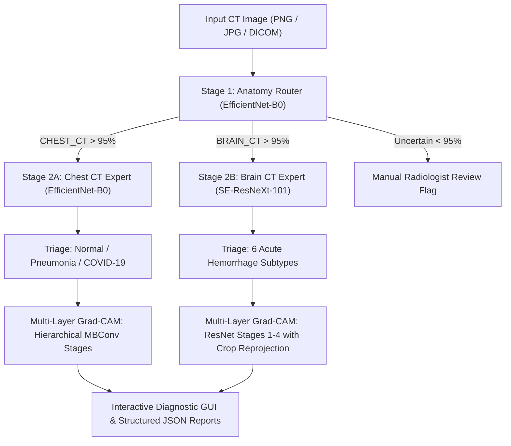

# CT Anatomy Router & Multi-Model Diagnostic AI System

[](https://www.python.org/downloads/)
[](https://pytorch.org/)
[]()
[](https://git-lfs.github.com/)

An end-to-end medical CT classification, downstream pathology triage, and explainable AI diagnostic framework. The system automatically routes incoming axial CT scans to specialized expert neural networks and provides anatomically grounded **Multi-Layer Grad-CAM** visualizations with zero coordinate misalignment.

---

## System Architecture



---

## Key Features

1. **Intelligent Anatomy Routing**:
   - High-throughput triage network (**EfficientNet-B0**) classifying axial CT scans into `BRAIN_CT` or `CHEST_CT` with >99.5% accuracy.
2. **Specialized Downstream Experts**:
   - **Chest CT Specialist**: Classifies scans into `Normal`, `Pneumonia`, and `COVID-19` with calibrated probabilities.
   - **Brain CT Specialist**: Multi-label detection across acute intracranial hemorrhage subtypes: `Any`, `Epidural`, `Intraparenchymal`, `Intraventricular`, `Subarachnoid`, and `Subdural`.
3. **Multi-Layer Gradient Projection Engine**:
   - Extracts backpropagated gradients and activations simultaneously across all model stages (`layer1` through `layer4`).
   - Dynamic energy weighting: $\omega_l = \sqrt{\text{mean}(|g^l|) \cdot \text{mean}(|A^l|)}$.
   - **Native Coordinate Reprojection**: Maps CAM heatmaps into the training crop bounding box (`crop_box_xywh`), preventing spatial dilation and skull boundary bleed.
   - **Anatomical Tissue Masking**: Filters non-tissue scanner air ($\text{HU} < 15$) to keep background regions clean.
4. **Interactive Dark-Theme GUI Dashboard**:
   - Built with native Tkinter (no external UI framework dependencies needed).
   - Side-by-side comparison of original CT slice and Grad-CAM overlay.
   - Interactive toggle between **Fused Overlay** and **Multi-Layer Grid** view.

---

## Project Structure

```
ct_anatomy_router_output/
│
├── predict.py                               # Primary Unified Entrypoint (CLI & GUI)
├── gui_predict.py                           # Dedicated GUI Launcher (Dark Theme)
├── pipeline_predict.py                      # Compatibility Forwarding Shim
├── test_brain.png                           # Sample Normal Brain CT Scan
├── test_chest.png                           # Sample Chest CT Scan
├── .gitattributes                           # Git LFS tracking rules (*.pt, *.pth)
│
├── src/                                     # Root Modular Inference Engine
│   ├── router.py                            # Anatomy Router Expert
│   ├── brain_expert.py                      # RSNA Brain Hemorrhage Specialist
│   ├── chest_expert.py                      # COVID/Pneumonia Chest Specialist
│   ├── gradcam.py                           # Multi-Layer Grad-CAM Engine
│   ├── inference.py                         # High-level MedicalCTPredictor API
│   ├── pipeline.py                          # Multi-stage routing pipeline
│   └── gui.py                               # Tkinter Dashboard Implementation
│
├── ct_anatomy_project/                      # Clean Architecture (MRI_Router Layout)
│   ├── src/                                 # Mirror of Modular Inference Engine
│   ├── models/                              # Model metadata & weights
│   │   ├── router/                          # best_router.pt
│   │   ├── chest/                           # best.pt
│   │   └── brain/                           # model_epoch_best_4.pth
│   ├── checkpoints/                         # Git LFS checkpoints
│   ├── predict.py
│   └── gui_predict.py
│
├── Covid19-CT-Scan--Detection/              # Chest Model Source Code & Architecture
│   ├── covid_ct_predict.py
│   ├── grad_cam.py
│   └── covidx_ct_results/checkpoints/best.pt
│
├── RSNA2019_Intracranial-Hemorrhage-Detection/ # Brain Model Source Code & Architecture
│   ├── rsna_ich_predict_gradcam.py
│   ├── model_epoch_best_4.pth
│   └── 2DNet/
│
├── samples/                                 # Evaluation and Diagnostic Images
│   └── user_brain_lesion.png                # Reference Intraparenchymal Hemorrhage Scan
└── predictions/                             # Auto-generated Run Artifacts
```

---

## Model Registry

| Model | Component Directory | Architecture | Target Classes | Checkpoint File | Size |
| :--- | :--- | :--- | :--- | :--- | :--- |
| **Model 1: Anatomy Router** | `models/router/` | `EfficientNet-B0` | `CHEST_CT`, `BRAIN_CT` | `best_router.pt` | 43.5 MB |
| **Model 2: Chest CT Expert** | `models/chest/` | `EfficientNet-B0` | `Normal`, `Pneumonia`, `COVID-19` | `best.pt` | 54.7 MB |
| **Model 3: Brain CT Expert** | `models/brain/` | `SE-ResNeXt-101` | 6 Hemorrhage Subtypes | `model_epoch_best_4.pth` | 188.4 MB |

> [!NOTE]
> All model weights (`*.pt`, `*.pth`) are tracked using **Git LFS**.

---

## Installation & Setup

### 1. Clone the Repository
```bash
git clone https://github.com/adityakollapudi/CT_Router.git
cd CT_Router
```

### 2. Pull Git LFS Model Weights
Ensure Git LFS is installed on your system ([Git LFS Install Guide](https://git-lfs.github.com/)):
```bash
git lfs install
git lfs pull
```

### 3. Install Dependencies
```bash
pip install torch torchvision torchaudio --index-url https://download.pytorch.org/whl/cu118  # or cpu
pip install opencv-python pillow numpy timm
```

---

## Command-Line Usage (CLI)

Run automated batch or single-scan analysis directly from your terminal:

```bash
# Predict on Brain CT scan (Multi-Layer Grad-CAM enabled by default)
python predict.py --cli --image test_brain.png

# Predict on Chest CT scan
python predict.py --cli --image test_chest.png

# Run with single-layer Grad-CAM only
python predict.py --cli --image test_brain.png --single-layer

# Fast inference mode (skip Grad-CAM generation)
python predict.py --cli --image test_brain.png --no-gradcam
```

Every run outputs structured JSON results and image overlays to `predictions/<scan_name>_<hash>/`:
- `prediction.json`: Full diagnostic breakdown, probabilities, routing status, and latency.
- `*_gradcam_overlay.png`: Coordinate-aligned high-contrast heatmap overlay.
- `*_gradcam_multilayer_grid.png`: Full progression grid (`Input CT` $\rightarrow$ `Layer 1` $\rightarrow$ `Layer 2` $\rightarrow$ `Layer 3` $\rightarrow$ `Layer 4` $\rightarrow$ `Fused`).

---

## How to Run This Project Using `gui_predict`

The interactive GUI provides a comprehensive, radiologist-friendly clinical decision support interface.

### Step 1: Launch the Application
Run the dedicated GUI launcher from the root folder:

```bash
python gui_predict.py
```

*(Alternatively, you can run `python predict.py` without arguments)*

You can also launch the GUI with a specific image pre-loaded into the viewer:
```bash
python gui_predict.py --image test_brain.png
```

---

### Step 2: Select an Input CT Scan
Once the window opens:
1. Click the **`Browse Image...`** button in the top control bar.
2. Select any CT scan slice (`.png`, `.jpg`, `.jpeg`). You can test immediately using the included samples:
   - `test_brain.png` (Normal Brain CT scan)
   - `test_chest.png` (Chest CT scan)
   - `samples/user_brain_lesion.png` (Acute Intracranial Hemorrhage scan)
3. Alternatively, type or paste the absolute file path directly into the **Image Path** input field.

---

### Step 3: Run AI Diagnostic Analysis
1. Click the vibrant blue **`Run Analysis`** button (or press `Enter`).
2. The pipeline executes:
   - **Step 1**: The Anatomy Router identifies the body region (Brain vs. Chest).
   - **Step 2**: The appropriate expert model runs inference and calculates class probabilities.
   - **Step 3**: The Multi-Layer Grad-CAM engine extracts layer gradients and projects the heatmap onto the image.

---

### Step 4: Interpret the Diagnostic Dashboard
The GUI dashboard displays three comprehensive inspection sections:

1. **Clinical Decision Banner**:
   - **Anatomy Badge**: Displays `BRAIN_CT` or `CHEST_CT` with confidence percentage.
   - **Diagnostic Badge**: Shows status (e.g., `[ SAFE ] Normal Scan` in green or `[ ALERT ] Hemorrhage Detected` in red).
   - **Primary Finding**: Highest probability condition and overall risk level.

2. **Dual-Panel Visualizer**:
   - **Left Panel (`Input CT Image`)**: Displays the given input axial slice.
   - **Right Panel (`Grad-CAM Based Image`)**: Displays the explainable AI visualization.
   - **View Mode Switcher**:
     - Click **`Fused Overlay`** to view the combined multi-layer gradient heatmap locked onto the lesion.
     - Click **`Multi-Layer Grid`** to inspect the step-by-step layer contributions (`layer1` fine texture $\to$ `layer4` semantic shape).

3. **Probability & Metrics Breakdown**:
   - Real-time colored horizontal progress bars for all disease classes.
   - Multi-layer contribution breakdown bars showing percentage energy per layer.
   - Latency indicator (ms) and loaded model architecture.

---

### Step 5: Saved Artifacts & Export
Every analysis run in the GUI automatically saves all high-resolution artifacts into the `predictions/` directory. You can locate:
- Complete JSON diagnostic reports.
- Full-resolution overlay PNGs suitable for publication or medical records.
- Layer-by-layer grid visualizations.
