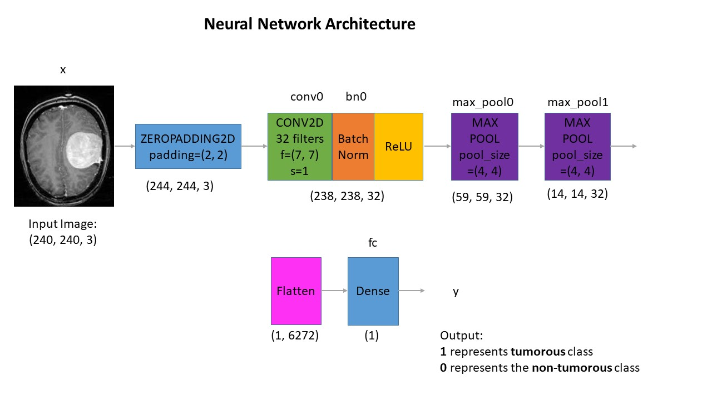
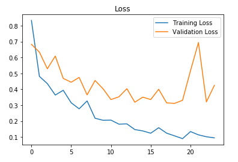
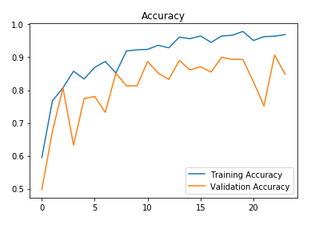

# Brain Tumor Detection with Explainable AI (Multi-Layer Grad-CAM)

A deep learning project for detecting brain tumors from MRI scans using a Convolutional Neural Network (CNN) in TensorFlow/Keras, featuring an interactive Streamlit web dashboard and **Multi-Layer Grad-CAM (Gradient-weighted Class Activation Mapping)** for visual lesion localization.

---

## Key Features

- **Binary Classification**: Classifies Brain MRI scans as either **Tumor Detected (Yes)** or **No Tumor (No)** with **91% validation accuracy** and **0.88 F1-score**.
- **Multi-Layer Grad-CAM Localization**: Aggregates gradients and activations across all intermediate convolutional and pooling layers (`conv0`, `bn0`, `activation`, `max_pool0`, `max_pool1`) to produce smooth, focused visual heatmaps highlighting the exact tumor mass without skull edge artifacts or pixel noise.
- **Interactive Web Dashboard**: Streamlit interface with scan upload, sample selection, colormap pickers, opacity adjustments, and real-time 4-panel diagnostic reports.
- **CLI & Automated Scripts**: Standalone prediction, evaluation, and training scripts with convenient Windows `.bat` launchers.
- **100% CPU Compatible**: Lightweight custom CNN architecture runs smoothly on standard laptops without requiring a dedicated GPU.

---

## Dataset Overview

The dataset is sourced from Kaggle's [Brain MRI Images for Brain Tumor Detection](https://www.kaggle.com/navoneel/brain-mri-images-for-brain-tumor-detection):
- **Original Dataset**: 253 MRI images (155 positive/tumor, 98 negative/healthy).
- **Augmented Dataset**: 2,065 images (1,085 positive, 980 negative) created using rotation, scaling, shifting, and flipping to prevent overfitting and balance class distribution.
- **Data Split**: 70% Training, 15% Validation, 15% Testing.

---

## Preprocessing Pipeline

Each MRI scan undergoes the following preprocessing steps:
1. **Contour Extraction & Cropping**: Uses OpenCV contour detection to isolate the brain parenchyma and crop extraneous black background.
2. **Standardized Resizing**: Resizes scans to `(240, 240, 3)` using bicubic interpolation.
3. **Min-Max Normalization**: Scales pixel intensities to the `[0, 1]` range.

---

## Neural Network Architecture



The network is designed for computational efficiency and strong generalization:
1. **ZeroPadding2D**: `(2, 2)` padding.
2. **Conv2D**: 32 filters, `(7, 7)` kernel, stride 1.
3. **BatchNormalization**: Normalizes channel distributions for accelerated convergence.
4. **ReLU Activation**: Non-linear rectification.
5. **MaxPooling2D**: Pool size `(4, 4)`, stride 4.
6. **MaxPooling2D**: Pool size `(4, 4)`, stride 4.
7. **Flatten**: Reshapes intermediate spatial tensors to 6,272 units.
8. **Dense (Output)**: 1 unit with Sigmoid activation for binary probability output.

---

## Model Performance

| Metric | Validation Set | Test Set |
| :--- | :---: | :---: |
| **Accuracy** | **91%** | **89%** |
| **F1-Score** | **0.91** | **0.88** |

### Training History

| Training & Validation Loss | Training & Validation Accuracy |
| :---: | :---: |
|  |  |

---

## Quickstart Guide

### 1. Run the Interactive Web UI
Launch the Streamlit web dashboard:
```powershell
streamlit run app.py
```
Or double-click `run_app.bat`.

### 2. Predict on an Image with Grad-CAM Heatmap
```powershell
python predict.py --image "yes/Y1.jpg" --gradcam
```
Or double-click `run_predict.bat`.

### 3. Generate a 4-Panel Grad-CAM Visualization
Produces a composite panel containing: `[Original Scan] | [Cropped Brain] | [Pure Heatmap] | [Superimposed Overlay]`.
```powershell
python gradcam.py --image "yes/Y1.jpg" --output "gradcam_result.jpg"
```
Or double-click `run_gradcam.bat`.

### 4. Evaluate Dataset Performance
```powershell
python evaluate.py --data original
```

### 5. Train Model from Scratch
```powershell
python train.py --epochs 25 --batch-size 32
```

---

## Project Structure

```text
├── app.py                         # Streamlit interactive web application
├── gradcam.py                     # Multi-layer Grad-CAM explainability module
├── predict.py                     # Inference script with brain contour cropping
├── evaluate.py                    # Test set evaluation and confusion matrix
├── train.py                       # Model training script
├── run_app.bat                    # One-click launcher for Web UI
├── run_gradcam.bat                # One-click launcher for Grad-CAM
├── run_predict.bat                # One-click launcher for CLI prediction
├── models/
│   ├── cnn-parameters-improvement-23-0.91.model  # Pretrained model weights
│   └── cnn-parameters-improvement-23-0.91.h5     # Exported HDF5 model
├── yes/                           # Positive MRI scan samples
├── no/                            # Negative MRI scan samples
├── augmented data/                # Augmented dataset for training
└── .gitignore                     # Git ignore rules for clean repository
```

---

## License

This project is licensed under the Apache License 2.0 - see the [LICENSE](LICENSE) file for details.